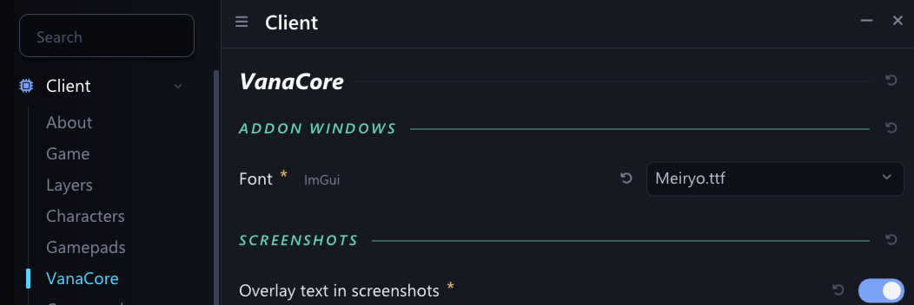

# Astertrail（アスタートレイル）

ファイナルファンタジーXI のクエスト・ミッション・エミネンス・レコードを、日本語の画面で見返すための **非公式** アドオンです。β 版です。

画面は日本語、クエスト名と NPC 名は英語のまま、報酬は資料の日本語名を使います。作者は Tsukasa です。

**版 1.1.211**（公開 β）／ データ `2026.11.16-112`

> **CatsEyeXI の承認待ちです。** いま CatsEyeXI のスタッフに使ってよいかを確認してもらっています。承認されるまでは、CatsEyeXI での使用は控えてください。

リポジトリ：https://github.com/Tsukasa-17/astertrail ／ ダウンロード：[Releases](https://github.com/Tsukasa-17/astertrail/releases)

## 動かす環境

**VanaCore 専用** です（Ashita v4 形式で書いてあり、VanaCore の Ashita 互換層で動かします）。

置き場所は `Vanacore\addons\vanacore\astertrail\` です。読み込みは次のとおりです。

```
/addon load astertrail vanacore
```

Ashita v4 単体での動作は保証しません（動作保証外です）。所持の数えや、ゲームのメニューとの重なりなど、一部の機能は VanaCore の窓口が無いと動きません（所持は「未確認」と出ます）。

## できること

- **冒険の本**：ミッション・クエスト・エミネンスの一覧。左に見出しの木（クエストは地域とエリア、ミッションは系列、エミネンスは分類。件数（達成数/総数）つき。いちばん上は「すべて」）、中央に項目の表、右に詳細です。地域や分類・状態・検索で表を絞り込めます。列の並びと幅、出す・隠すを変えられ、タブごとに覚えます。行を選ぶと右側に詳細、ダブルクリックで詳細だけの窓になります。本を閉じているときは、画面の入口アイコンから開けます。
- **詳細**：場所と発生 NPC、状態（未受注・受注中・完了。ゲームの記録から読みます）、手順と今の手順（自分で選べます）、ピン留め。相手の名前を押すと地図を開きます。出典は画面に出しません。
- **トラッカー**：ピン留めしたものを最大 10 件まで（数は設定で変えられます）。ミッションはいつも上。今の手順、時間帯・天候（資料にあるときだけ）、必要な品の所持、◀▶ で手順を送れます。一覧とタブの出し方を選べます。
- **エミネンス**：受けているものと進みを小さな窓に出せます（初期は隠す）。本の「エミネンス」タブで全部のレコードを見られ、「受ける」「解除」は **押したときに 1 回だけ**、ゲームのメニューと同じ通信を送ります（自動では送りません）。名前・目標・報酬などは、手元のゲームのデータファイルから読みます（同梱しません）。お気に入りと ★（窓のピン）は別です。「達成済みを非表示」にしても、くり返しできるものは残します。
- **コンパス**：いまいるエリアで受けられるクエストを、近い順に出します（初期は隠す）。
- **地図**：手順の場所に印を出します。地図の画像は同梱せず、手元のクライアントの地図 DAT を実行時に読みます（読めなければマス目の方眼になります）。自分の位置、となりのエリアへの出口、着いた位置の輪（◎）が出ます。出口がどの階層にあるか分からないときは置きません。
- **アイコンと足元の輪**：見えている相手にだけ、クエストの状態に合わせた印を出します（未受注・受注中・討伐・ゲートガード・名声を教えてくれる人など）。討伐は、手順に名前や種族が書いてあるモンスターに出します。印を付けた相手の足元には、同じ色の光の輪が出ます。自分の絵に差し替えるときは、`assets/marks/` に PNG を置きます。無い名前は `assets/marks/example/` の絵を使います。詳しくはそのフォルダの `README.txt` を見てください。`/astertrail icons` で読み直せます。
- **所持**：手順の必要品を、かばん・金庫・金庫2・モグ収納・モグロッカー・サッチェル・サック・ケース・ワードローブ1〜8 から数えます（テンポラリは数えません）。足りていれば「○」、足りなければ「持っている数/必要な数」。マウスを乗せると、どこにいくつあるかが出ます。まだ読み込まれていない入れ物は空とみなさず「未確認」と出します。持っているだけで手順は終わりません。報酬は数えません。
- **お知らせと効果音**：ログイン時の「前回の続き」（初期はオフ。設定の「お知らせ」で出せます）。遊んでいるあいだにクエスト・ミッションを受けた・終えたときは、ふわっと出る知らせと、このアドオンで作った、明るい長調の短いファンファーレを出します（ゲームやほかのアドオンの音は使いません。よく知られた既存のメロディは使いません）。ピン留めするかどうかを聞けます（ボタンは中央。出ているあいだはパッドで選べます）。設定の「お知らせ」で効果音の音量を 0〜100%（10% きざみ、初期 70%、0 は無音）に変えられ、受注時・完了時の表示を試せます。
- **ゲームの記録**：受注・完了を、ゲームが持っている記録から合わせます（読むだけです）。つながるのは 1547 件で、282 件はつながりません（後述）。
- **マイレイアウト**：設定の「保存」に 5 つの枠があります。各窓の位置・大きさ・出す／隠すと、見た目や列などの設定を覚えられます。進行・ピン・お気に入り・名声・デバッグは入りません。
- **ショートカット**：設定の「操作」で、本を開く、トラッカーの表示／非表示と操作、エミネンスとコンパスの表示／非表示を、パッドのボタンの組み合わせに割り当てられます（初期値はなし）。
- **見た目**：初期はクラシックです。設定の「見た目」で YunaUI 風に変えられます。文字サイズと背景の濃さは窓ごとに変えられます。自分で決めた窓の大きさは、文字サイズを変えてもそのままです。

## 入れ方と更新

1. [Releases](https://github.com/Tsukasa-17/astertrail/releases) から `astertrail-1.1.211.zip` などの zip を取ってきて展開し、フォルダ名が `astertrail` であることを確認します（中に `astertrail.lua` があります）。
2. そのフォルダを `Vanacore\addons\vanacore\astertrail\` に置きます。
3. ゲームで `/addon load astertrail vanacore` と打ちます。毎回読むときは、ほかのアドオンと同じく `boot.txt` などに `//addon load astertrail vanacore` を足します。
4. 外すときは `/addon unload astertrail` です。

このアドオンは ImGui を使っています。使う前に、VanaCore の設定で ImGui のフォントを、日本語に対応したものにしておく必要があります。場所は **Client > VanaCore > ADDON WINDOWS > Font (ImGui)** です。例：`meiryo.ttc`（日本語の出るフォントならほかでも構いません）。日本語に対応していないフォントのままだと、画面の文字が出ません。



更新するときは、同じ場所の `astertrail` フォルダを新しいものに差し替えます。進行と設定は次の場所に残るので、上書きされません。自分で置いたアイコン（`assets/marks/` の PNG。`example/` 以外）も、更新では上書きしません。

```
Vanacore\config\addons\astertrail\catseye_<キャラ名>\
  progress.json     進み具合
  settings.json     設定（窓の位置も含む）
  layouts.json      マイレイアウト
  *.bak / backups\  自動のバックアップ
```

`dev\` などの開発用ファイルは、ゲームで使うには不要です。（`dev\sources\` など、ほかのプロジェクトの資料やゲームのデータファイルはリポジトリに入れていません。データを作り直すスクリプトはそれらが手元にあるときだけ動きます）

## コマンド

`/astertrail` のほか、短い `/ast` でも同じです（サブコマンドも含みます）。

| コマンド | 内容 |
|---|---|
| `/astertrail` または `/ast` または `open` | 冒険の本を開く |
| `/astertrail toggle` | 本を開く／閉じる |
| `/astertrail close` | トラッカー以外の窓を閉じる |
| `/astertrail tracker show` / `hide` / `focus` | トラッカーを出す／隠す／操作する |
| `/astertrail compass [show/hide]` | コンパスを出す／隠す（引数なしで切り替え） |
| `/astertrail eminence [show/hide]` | エミネンスの窓を出す／隠す（引数なしで切り替え） |
| `/astertrail settings` | 本を設定の表示で開く |
| `/astertrail map` | 地図を開く |
| `/astertrail marks [on/off]` | アイコンのオン／オフ（引数なしで切り替え） |
| `/astertrail icons` | 自分のアイコンを読み直す |
| `/astertrail focus` | 開いている窓を操作する |
| `/astertrail notice` | 出ているお知らせを操作する |
| `/astertrail release` | 操作をやめて、入力をゲームへ戻す |
| `/astertrail save` | 今すぐ保存する |
| `/astertrail status` | 版・データ・キャラ・状態を表示する |
| `/astertrail floor` | いまいる階の判定を表示する |
| `/astertrail target`（別名 `pos`） | いまのターゲットの座標を表示する |
| `/astertrail gamelog [read]` | ゲームの記録の読み取りの様子。`read` で読み直す |
| `/astertrail roe [read/reload]` | エミネンスの読み取りの様子。`read` で読み直し、`reload` でデータファイルを読み直す |
| `/astertrail menus` | ゲームのメニューの読み取りの様子 |
| `/astertrail debug perf [on/off/show]` | 重さの計測（初期はオフ）。`show` で平均を出す |
| `/astertrail resetlayout` | 窓を初期配置に戻す |

引数が分からないときは、使い方がチャットに出ます。

## 設定

設定は本の中に、タブで出ます。⚙️、ゲームのコンフィグのボタン、`/astertrail settings` のどれでも開けます。

- **見た目**：YunaUI 風／クラシック、文字サイズ、背景の濃さ、動きを減らす
- **配置**：配置のロック、初期配置に戻す、入口アイコン、前回の位置を覚える、コンパスを出す
- **トラッカー**：出す、件数の上限、出し方（一覧／タブ）、そろえ、× を出す、所持の欄
- **地図**：地図を使う
- **アイコン**：印・名前・足元の輪・位置や色、ズームに合わせた位置（試し）、名声の人の印
- **お知らせ**：ログインの続き、受注・完了のお知らせと効果音
- **操作**：パッドで画面を操作、ショートカット、ゲームのメニューとのつなぎ
- **保存**：今すぐ保存、マイレイアウト
- **エミネンス**：本で達成したものを隠す、など
- **このアドオンについて**：版とデータの版、アップデートのお知らせ（オン／オフ）

## 操作の要点

- **マウス**：普通にクリック。アドオンの窓の外をクリックすると、操作をやめます。
- **キーボード**（操作中だけ）：本では、左の見出しの木で ↑↓に見出しを選び、←で閉じる・→で開く（開いていれば下の見出しへ）、Enter で中央の一覧へ入ります。一覧では ↑↓で行、←→は同じ行の中、Esc で見出しへ戻ります。見出しの木で Esc を押すと本を閉じます。Tab／Shift+Tab で場所（絞り込み・見出し・一覧・詳細）を移動します。タブ（ミッション／クエスト／エミネンス）は上の行です。
- **パッド**（操作中、または受注・完了のお知らせが出ているとき）：本では、左の見出しの木で上下に見出しを選び、左右で開く・閉じる（右で下の見出しへ）、決定で中央の一覧へ入ります。一覧では上下で行、左右は行の中、キャンセルで見出しへ戻ります。見出しの木でキャンセルすると本を閉じます。LB／RB で場所（絞り込み・見出し・一覧・詳細）を移動します。ショートカットは設定の「操作」で決めます（初期値はなし）。
- トラッカーは、見えているだけではキーもパッドも受け取りません（操作のショートカットで操作します）。
- 受注・完了のお知らせが出ているあいだは、パッドで「ピン留めする／しない」を選べます（決定で押す、キャンセルで閉じる）。閉じたあと、ゲームのボタンが押しっぱなしにならないよう入力を離します。キーで操作するときは `/astertrail notice`（`/ast notice`）か、ほかの窓を操作しているときです。

## わかっている制限（β）

- これは β 版です。まだ変わることがあり、不具合もあるかもしれません。
- 収録はクエスト・ミッション 1829 件です。このうち **ゲームの記録とつながるのは 1547 件** で、**282 件はつながりません**（カンパニエ・TVR、一部のミッションなど）。つながらないものは、受注・完了が自動では変わりません（公開版では手で変える操作はありません）。
- 手順ごとの進み具合は、ゲームから自動では読みません（受注・完了だけです）。
- 名声の段階は、ゲームの数値としては読めません。名声を教えてくれる人に話すと覚えます。
- 最後の手順をチェックしても、クエストは自動では完了になりません。
- CatsEye 独自のクエストは入れていません。
- アイテムを移す・売る・捨てる・渡す通信は送りません。ゲームへ送る通信は、エミネンスの「受ける」「解除」を押したときの 1 回だけです。
- アップデートのお知らせがオンのとき、読み込んだあとに 1 回だけ、このリポジトリの `version.json`（https://raw.githubusercontent.com/Tsukasa-17/astertrail/main/version.json）を読みます。読むだけで、ほかの通信はしません。つながらないときは何もしません。設定の「このアドオンについて」で止められます。
- Ashita v4 単体は動作保証外です。地図の出口や階が分からない場所では、印を置かないことがあります。

## クレジット

一覧と手順の参照は、[FF11用語辞典](https://wiki.ffo.jp/) を主な資料にしています。足りないところは BG Wiki、LandSandBoat（LSB）、HorizonXI を確認しています。手順の文は独自に書いた短い要約で、記事の本文は含みません。Journal や Questlog のデータは使っていません。

画面の作りは YunaUI を参考にしています（コードは写していません）。**Based on YunaUI by Yunas — https://github.com/YunasXI/yunaui**

## 非公式であること

このアドオンはファンメイドの非公式なものです。Square Enix とは関係がなく、公式のものでもありません。CatsEyeXI や VanaCore とも関係がありません。ゲームの画像・音・データファイルは同梱しません。地図は、実行時に手元のクライアントの DAT を読むだけです。効果音は自作です。

## ライセンス

[GNU General Public License v3.0](LICENSE) です。

Copyright (C) 2026 Tsukasa

リポジトリ：https://github.com/Tsukasa-17/astertrail

---

# English

> **Pending CatsEyeXI approval.** This addon is currently under review by the CatsEyeXI staff. Please do not use it on CatsEyeXI until it has been approved.

Astertrail is an **unofficial** fan-made addon for Final Fantasy XI. It helps you follow quests, missions, and Eminence records in a Japanese UI (quest and NPC names stay in English). This is a public **β** release (v1.1.211, data `2026.11.16-112`). Repository: https://github.com/Tsukasa-17/astertrail (downloads on the Releases page). Author: Tsukasa.

It is **VanaCore only** (Ashita v4 addon format, loaded through VanaCore's compatibility layer). Place the `astertrail` folder at `Vanacore\addons\vanacore\astertrail\` and run `/addon load astertrail vanacore`. Standalone Ashita v4 is not supported (no guarantee of operation); some features need VanaCore.

This addon uses ImGui. Before using it, in the VanaCore client settings (**Client > VanaCore > ADDON WINDOWS > Font (ImGui)**), set the ImGui font to a Japanese-capable font such as `meiryo.ttc` (any Japanese-capable font is fine). Otherwise Japanese text will not display. See the screenshot in the Japanese setup section above.

Commands: `/astertrail` and the short alias `/ast` accept the same subcommands.

In the book, with a pad or keys, up/down picks a heading (or a row) at the current level, confirm enters a heading (opening it if it was closed), left/right on a heading closes or opens it, and cancel goes up one level (cancel at the top heading closes the book). In a row, left/right still moves within the row, and LB/RB or Tab changes area.

To update, replace the addon folder. Progress and settings stay in `Vanacore\config\addons\astertrail\catseye_<character>\`.

It is not affiliated with or endorsed by Square Enix, CatsEyeXI, or VanaCore. No game assets are bundled. Maps are read from your local client DAT files at runtime. Sounds are original. Of 1829 quests and missions, 1547 can be matched to the game's records; **282 cannot** (including Campaign, TVR, and some missions).

Update notice: when enabled, the addon reads this repository's `version.json` once after loading (read-only) and prints one chat line if a newer version exists. You can turn it off in the settings.

License: [GNU GPL v3.0](LICENSE).

Reference sources (not shown in the in-game UI): FF11 Yougo Jiten (https://wiki.ffo.jp/), with gaps checked against BG Wiki, LandSandBoat, and HorizonXI. Step text is our own short summary, not copied article text. Look is inspired by YunaUI (no code copied): Based on YunaUI by Yunas — https://github.com/YunasXI/yunaui
